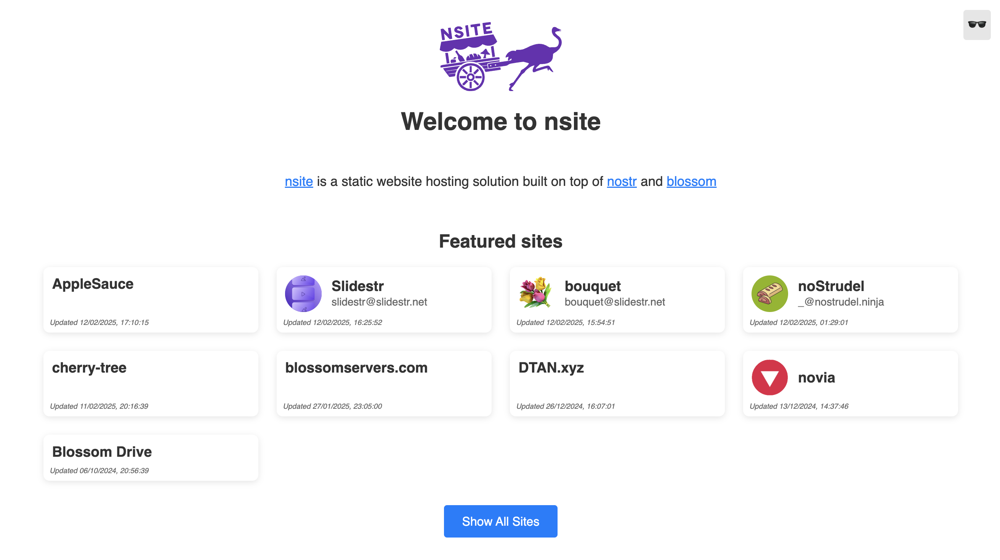

# nsite-homepage

A simple react app that can be used as a homepage for [nsite-ts](https://github.com/hzrd149/nsite-gateway)

Canonical nsite URLs follow the updated `nsite.md` format:

- Root site: `<npub>.<host>`
- Named site: `<50-char-pubkeyB36><dTag>.<host>` where `dTag` matches
  `^[a-z0-9-]{1,13}$` and does not end with `-`

If you deploy this homepage behind a custom landing-page host, set `VITE_NSITE_HOST`
to the canonical base host so generated site links resolve correctly:

```bash
VITE_NSITE_HOST=nsite.lol
```

```
NSITE_HOMEPAGE="nprofile1qqspspfsrjnurtf0jdyswm8jstustv7pu4qw3pn4u99etptvgzm4uvcpz9mhxue69uhkummnw3e82efwvdhk6qg5waehxw309aex2mrp0yhxgctdw4eju6t04mzfem"
```


